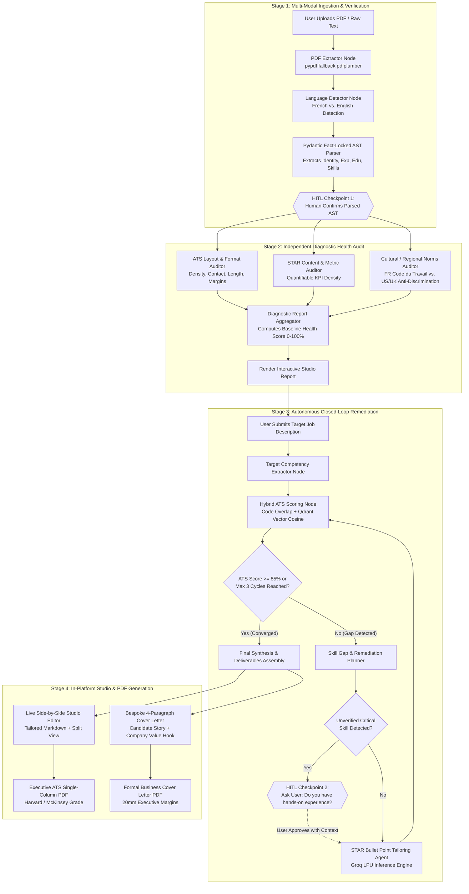
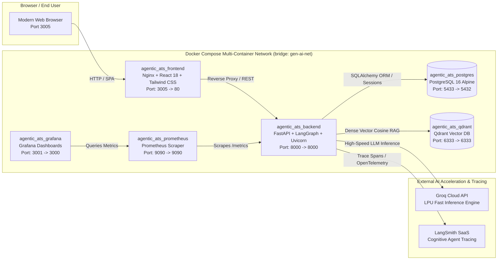

<div align="center">

# AgenticATS: Autonomous Multi-Agent ATS Intelligence & Career Studio

**A Production-Ready, Closed-Loop Multi-Agent State Machine built with LangGraph, FastAPI, React (Tailwind CSS Light Theme), Groq LPU, PostgreSQL, and Qdrant Vector Store.**

[](https://fastapi.tiangolo.com)
[](https://react.dev)
[](https://github.com/langchain-ai/langgraph)
[](https://groq.com)
[](https://www.postgresql.org)
[](https://qdrant.tech)
[](https://www.docker.com)
[](https://prometheus.io)

</div>

---

## Table of Contents
- [Executive Overview & The "Vibes-Based" ATS Fallacy](#executive-overview--the-vibes-based-ats-fallacy)
- [Core Differentiators: What Makes AgenticATS Unique](#core-differentiators-what-makes-agenticats-unique)
- [System Architecture & Multi-Agent Swarm](#system-architecture--multi-agent-swarm)
  - [LangGraph State Machine Architecture](#langgraph-state-machine-architecture)
  - [The 6-Agent Swarm Hierarchy](#the-6-agent-swarm-hierarchy)
  - [Containerized Multi-Service Topology](#containerized-multi-service-topology)
- [Mathematical Foundation: Deterministic Hybrid ATS Scoring](#mathematical-foundation-deterministic-hybrid-ats-scoring)
- [Live Demo & Quick Start](#live-demo--quick-start)
  - [Demo User Credentials](#demo-user-credentials)
  - [1-Command Docker Launch](#1-command-docker-launch)
  - [Local Development Setup](#local-development-setup)
- [Software Engineering, Observability & Metrics](#software-engineering-observability--metrics)
  - [Prometheus Monitoring](#prometheus-monitoring)
  - [LangSmith Cognitive Agent Tracing](#langsmith-cognitive-agent-tracing)
  - [Automated Test Suite & Real-World Validation](#automated-test-suite--real-world-validation)
- [CI/CD Pipeline (GitHub Actions)](#cicd-pipeline-github-actions)
- [API Reference](#api-reference)
- [Executive Harvard/McKinsey ATS PDF Specification](#executive-harvardmckinsey-ats-pdf-specification)

---

## Executive Overview & The "Vibes-Based" ATS Fallacy

Most AI resume builders and generic LLM prompts suffer from critical algorithmic flaws:
1. **Hallucinated ATS Scores:** Standard LLM prompts invent an arbitrary score (*"Your resume scores 88/100!"*) based purely on generative vibes with zero mathematical or keyword grounding.
2. **Pathological Sycophancy & Fabrication:** Standard generative prompts eagerly fabricate job experiences, invent technical skills, or alter graduation years to falsely match a Job Description.
3. **Open-Loop Generation:** A conventional ChatGPT prompt generates text in a single pass without testing its own output against an ATS scoring parser or iterating toward convergence.
4. **Poor Document Formatting:** Exported resumes suffer from broken margins, awkward line wraps, Unicode encoding bugs (e.g., `?` instead of bullet points), or clumsy headers that insert the prospective employer's company name into the applicant's title.

**AgenticATS** completely reinvents this paradigm by separating **Deterministic Verification (The Judge)** from **Autonomous Generative Intelligence (The Worker)**.

---

## Core Differentiators: What Makes AgenticATS Unique

| Traditional AI Assistants (ChatGPT, Claude) | AgenticATS Autonomous Studio |
| :--- | :--- |
| **Open-Loop Prompting:** Single-pass text generation with no automated verification. | **Closed-Loop Convergence:** LangGraph cyclic graph executes up to 3 optimization cycles until ATS target threshold (>=85%) is proven. |
| **Hallucinated Scores:** Fake confidence scores without verifiable metrics. | **Deterministic Hybrid Scoring:** Pure mathematical formula combining BM25/Exact Token Overlap + Qdrant Dense Vector Cosine Similarity + Action Verb Density. |
| **Prone to Sycophantic Hallucinations:** Fabricates degrees, skills, or fake employers. | **Fact-Locked AST & Ethical HITL Gate:** Employment dates, companies, and degrees are immutable. Unverified skills trigger Human-in-the-Loop approval before inclusion. |
| **Fragile Formatting:** Generates markdown with inconsistent margins, broken accents, or overlapping headings. | **Executive Harvard/McKinsey ATS PDF Exporter:** Pixel-perfect 14mm margins, solid round bullets (`•`), hanging indents, orphan heading guards, and separate cover letter layouts. |
| **Monolithic Single Prompt:** One prompt handles parsing, critiquing, and rewriting simultaneously. | **Specialized 6-Agent Swarm:** Dedicated agents for Layout Audit, STAR Metrics, Regional Cultural Norms (FR vs. US/UK), Gap Analysis, STAR Tailoring, and Cover Letter Synthesis. |

---

## System Architecture & Multi-Agent Swarm

### LangGraph State Machine Architecture

AgenticATS runs as a cyclical, stateful directed graph managed by **LangGraph**. The workflow preserves session state across user interactions and implements Human-in-the-Loop (HITL) checkpoints.



---

### The 6-Agent Swarm Hierarchy

1. **Ingestion & AST Fact-Lock Agent (`app/agents/parser_agent.py`):**
   - Extracts candidate profile, contact details, experiences, degrees, and technical skills into a structured Pydantic model.
   - Seals verified company names, dates, and institutions so downstream generative agents cannot fabricate timeline details.
2. **ATS Layout & Readability Auditor (`app/agents/diagnostic_agent.py`):**
   - Inspects line density, contact completeness, bullet lengths, and structural ATS readability.
3. **STAR Methodology & Metrics Auditor (`app/agents/diagnostic_agent.py`):**
   - Evaluates bullet points for Situation, Task, Action, and quantifiable Result (percentages, dollar amounts, throughput metrics).
4. **Cultural & Regional Compliance Agent (`app/agents/diagnostic_agent.py`):**
   - Applies regional compliance rules: flags personal photos, birthdates, or marital status for US/UK submissions (anti-discrimination compliance); checks for French CV standards.
5. **STAR Bullet Tailoring Agent (`app/agents/tailoring_agent.py`):**
   - Autonomously rewrites bullet points to integrate missing target competencies using active verbs and quantifiable business impact, powered by Groq LPU inference.
6. **Executive Synthesis & Cover Letter Agent (`app/agents/synthesis_agent.py`):**
   - Assembles clean, professional markdown resumes, completely stripping prospective company names from candidate headlines.
   - Authors a high-conversion, 4-paragraph formal cover letter linking candidate achievements to company objectives.

---

### Containerized Multi-Service Topology

The system is deployed as a **containerized multi-service architecture** composed of isolated, purpose-built service containers orchestrated via Docker Compose:
- **Presentation Service:** React 18 SPA served via Nginx reverse proxy.
- **Application & Intelligence Service:** FastAPI backend orchestrating the in-process LangGraph multi-agent cognitive pipeline.
- **Relational Persistence Service:** PostgreSQL 16 Alpine managing users, sessions, and audit histories.
- **Vector Search Service:** Qdrant Vector DB handling dense semantic embeddings and cosine similarity retrieval.
- **Observability Suite:** Prometheus scraping application metrics and Grafana rendering real-time telemetry dashboards.

*Note: Rather than introducing the unnecessary network serialization, eventual consistency, and operational overhead of distributed microservices for an agentic cognitive loop, the multi-agent swarm executes as a stateful, low-latency directed graph within the backend service, while infrastructure concerns are strictly isolated across dedicated service containers.*



---

## Mathematical Foundation: Deterministic Hybrid ATS Scoring

Unlike generic AI tools that hallucinate a rating, AgenticATS implements a deterministic mathematical scoring equation:

$$\text{Final ATS Score} = \left( 0.40 \times S_{\text{keyword}} \right) + \left( 0.40 \times S_{\text{vector}} \right) + \left( 0.20 \times S_{\text{star}} \right)$$

Where:
- **$S_{\text{keyword}}$ (Exact & Stemmed Match):**

  $$S_{\text{keyword}} = \frac{|\text{Tokens}(\text{Resume}) \cap \text{Tokens}(\text{Job Description})|}{|\text{Tokens}(\text{Job Description})|} \times 100$$

- **$S_{\text{vector}}$ (Semantic Cosine Similarity):**
  Embeddings $\mathbf{u}$ (resume) and $\mathbf{v}$ (job description) projected into dense vector space:

  $$S_{\text{vector}} = \frac{\mathbf{u} \cdot \mathbf{v}}{\|\mathbf{u}\|_2 \|\mathbf{v}\|_2} \times 100$$

- **$S_{\text{star}}$ (Action-Metric Density):**
  Percentage of experience bullet points containing an active verb paired with quantifiable impact metrics (numbers, %, \$).

---

## Live Demo & Quick Start

### Demo User Credentials
The system comes pre-seeded with an executive demonstration profile and 10 curated, production-grade threads:

| Field | Demo Credential |
| :--- | :--- |
| **Email** | `demo@agenticats.com` |
| **Password** | `Password123!` |
| **Candidate** | Ali BENHIMA (Software Engineer / Full Stack & GenAI) |
| **10 Pre-Loaded Target Roles** | 1. Wavestone Casablanca (ALMA Consultant.e Stagiaire)<br/>2. BCG X Delivery (Software Engineering Intern)<br/>3. Deloitte Afrique (Stagiaire Conseil en Technologies)<br/>4. Visa Consulting & Analytics (VCA Intern)<br/>5. Ostorlab (Cybersecurity & Security Platform Intern)<br/>6. Capgemini Engineering (Smart Carpool Back-End)<br/>7. Sofrecom Orange Group (Full Stack Java/Angular)<br/>8. Capgemini Data & AI (Stagiaire PFE Data & AI)<br/>9. VISEO (Senior SWE LLMs & GenAI)<br/>10. ChainGPT (AI-Native Software Engineer) |

### 1-Command Docker Launch

```bash
# 1. Clone repository
git clone https://github.com/AliBnh/agentic-ats.git
cd agentic-ats

# 2. Configure environment
# Copy .env.example to .env and configure GROQ_API_KEY (and optional LANGCHAIN_API_KEY)

# 3. Launch the containerized stack
docker compose up -d --build
```

**Access Endpoints:**
- **Web Application Studio:** [http://localhost:3005](http://localhost:3005)
- **FastAPI Interactive Docs (Swagger):** [http://localhost:8000/docs](http://localhost:8000/docs)
- **Grafana Swarm Observability Dashboard:** [http://localhost:3001](http://localhost:3001) *(Auth: `admin` / `admin`)*
- **Prometheus Metric Scraper & UI:** [http://localhost:9090](http://localhost:9090)
- **FastAPI Metrics Endpoint:** [http://localhost:8000/metrics](http://localhost:8000/metrics)
- **Qdrant Vector Dashboard:** [http://localhost:6333/dashboard](http://localhost:6333/dashboard)

---

### Local Development Setup

#### Backend Setup
```bash
cd backend
python -m venv venv
# Windows:
.\venv\Scripts\activate
# Linux/macOS:
source venv/bin/activate

pip install -r requirements.txt
uvicorn app.main:app --host 0.0.0.0 --port 8000 --reload
```

#### Frontend Setup
```bash
cd frontend
npm install
npm run dev
# Vite runs at http://localhost:3005
```

---

## Software Engineering, Observability & Metrics

### Prometheus & Grafana Swarm Observability
AgenticATS provides enterprise-grade observability via native Prometheus instrumentation on `/metrics` and a pre-configured Grafana monitoring suite:
- **`http_requests_total`**: Tracks total API traffic labeled by `method`, `endpoint`, and `status`.
- **`http_request_duration_seconds`**: Histogram measuring API latency with low-cardinality endpoint normalization.
- **`ats_audits_total`**: Real-time counter of resume audits, language detections (FR vs. EN), and upload status.
- **`ats_job_matches_total`**: Counter measuring complete target job alignment runs.
- **`ats_hitl_interrupts_total`**: Tracks Human-In-The-Loop checkpoint states (`triggered` vs `resolved`).
- **`ats_final_scores`**: Distribution histogram of ATS convergence scores (0-100%).

#### Instant Grafana Access
- **URL:** [http://localhost:3001](http://localhost:3001)
- **Default Login:** `admin` / `admin`
- **Pre-provisioned Dashboard:** *"AgenticATS Swarm Intelligence & Observability"* is automatically loaded upon launch, showcasing real-time stat cards, p50/p95 latency timeseries, language distribution donut charts, and HITL state breakdowns.

### LangSmith Cognitive Agent Tracing
AgenticATS natively integrates **LangSmith** for deep observability into the internal decisions of the LangGraph multi-agent swarm:
- **Hierarchical Flame Graphs:** Visual execution trees of each LangGraph node (`ingestion` -> `diagnostic` -> `scoring` -> `gap_analyzer` -> `tailoring` -> `synthesis`).
- **Token Accounting & Latency:** Real-time token usage and latency metrics per Groq LPU call across optimization cycles.
- **Human-In-The-Loop Traces:** Visual checkpoints showing the exact moment execution paused for skill confirmation and state resumption.
- **To Enable:** Simply add your free key to `.env`:
  ```env
  LANGCHAIN_TRACING_V2=true
  LANGCHAIN_API_KEY=your_langsmith_api_key_here
  LANGCHAIN_PROJECT=agentic-ats
  ```
*(Tracing is 100% non-blocking and defaults to inactive if no key is provided).*

---

## CI/CD Pipeline (GitHub Actions)

A battle-tested CI/CD workflow is included at `.github/workflows/ci.yml`:
1. **Backend CI (`Python 3.11`):** Installs dependencies, runs code compilation checks (`compileall`), and executes the complete `pytest` unit & multi-agent graph test suite.
2. **Frontend CI (`Node.js 20`):** Installs frontend dependencies and verifies Vite asset production compilation (`npm run build`).
3. **Docker Compose Validation:** Validates container composition and configuration integrity.

To push this repository to GitHub:
```bash
# 1. Initialize git and commit
git init
git add .
git commit -m "feat: initial release of AgenticATS production platform"

# 2. Add your remote repository and push
git remote add origin https://github.com/AliBnh/agentic-ats.git
git branch -M main
git push -u origin main
```

---

### Automated Test Suite & Real-World Validation

The project includes automated test coverage validating every pipeline stage:

```bash
# 1. Run unit & graph integration tests
docker exec agentic_ats_backend pytest tests/test_engine.py -v

# 2. Run 10 Real-World Diverse Tech Scenarios Test Suite
docker exec agentic_ats_backend python tests/test_10_real_scenarios.py
```

The **10 Real-World Scenarios Test Suite** validates end-to-end processing across 10 diverse technical domains:
1. **Cloud & Distributed Systems:** AWS/GCP Multi-Region EKS, Terraform, Prometheus/Grafana.
2. **Senior Data Science & ML:** Banking predictive scoring, XGBoost, PyTorch, MLOps.
3. **Application Security & DevSecOps:** SAST/DAST, OWASP Top 10, penetration testing.
4. **Lead Frontend Engineer:** React 18, TypeScript, Tailwind CSS, Web Performance Core Web Vitals.
5. **Technical Product Manager:** B2B SaaS, Agile sprints, discovery, user retention metrics.
6. **Core Java Enterprise Backend:** Spring Boot 3, Apache Kafka, event-driven distributed systems.
7. **IT Strategy & Transformation Consultant:** Cloud migration roadmaps, IT governance, C-level executive advisory.
8. **Site Reliability Engineer (SRE):** Kubernetes, Chaos Engineering, SLIs/SLOs, Incident response.
9. **Full Stack GenAI Engineer:** RAG architectures, LangChain, vector databases, FastAPI.
10. **LLM Research Scientist:** Fine-tuning, LoRA/QLoRA, RLHF, transformer attention mechanics.

*Note: The test suite automatically cleans up all 10 temporary test threads upon completion, leaving only curated demo data in PostgreSQL.*

---

## API Reference

| Method | Endpoint | Description |
| :--- | :--- | :--- |
| `POST` | `/api/auth/login` | Authenticate user and receive JWT bearer token |
| `POST` | `/api/auth/register` | Register new applicant account |
| `GET` | `/api/auth/me` | Fetch active user identity |
| `POST` | `/api/audit/upload` | Ingest PDF or plain text resume; runs AST parsing & language detection |
| `POST` | `/api/audit/confirm-parsing` | HITL Breakpoint 1: Confirm or adjust parsed candidate AST |
| `POST` | `/api/audit/match-job` | Submit Job Description; executes deterministic scoring and triggers remediation |
| `POST` | `/api/audit/resume/{thread_id}` | HITL Breakpoint 2: Submit user verification for missing technical competencies |
| `GET` | `/api/audit/result/{thread_id}` | Retrieve comprehensive audit report, scores, tailored markdown, and cover letter |
| `POST` | `/api/audit/export/pdf` | Export executive Harvard/McKinsey ATS single-column PDF or formal cover letter |
| `GET` | `/api/threads` | List user resume audit sessions |
| `DELETE` | `/api/threads/{thread_id}` | Delete an audit thread and its associated artifacts |
| `GET` | `/metrics` | Prometheus metrics scrape endpoint |

---

## Executive Harvard/McKinsey ATS PDF Specification

The PDF exporter (`backend/app/utils/pdf_exporter.py`) was engineered according to the strictest ATS scanning and typography specifications:
- **Geometry:** 14mm margins for maximum printable real estate without triggering printer edge clipping.
- **Typography:** Pure clean Helvetica styling, uppercase primary section titles (`EXPERIENCE`, `EDUCATION`, `SKILLS`) with subtle rule dividers.
- **Bullet Rendering:** Solid round bullets (`chr(149)` / `•`) rendered in pure Latin-1 to eliminate broken character glyphs (`?`).
- **Hanging Indentation:** Sub-bullets wrap with a precise 5mm hanging indent (text lines never wrap under bullet dots).
- **Orphan Guard:** Automatic page break if fewer than 42mm remain on the page before rendering an experience block.
- **Header Cleanliness:** Zero prospective employer names in candidate titles; candidate's professional headline is preserved without company branding.
- **Dedicated Cover Letter Mode:** Renders formal executive correspondence with 20mm margins, header date block, bold subject line, and balanced paragraph spacing.

---

<div align="center">
<strong>AgenticATS</strong> — Built with excellence for modern software engineering teams and career professionals.
</div>
