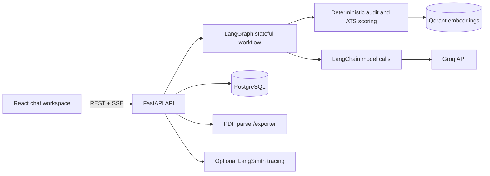
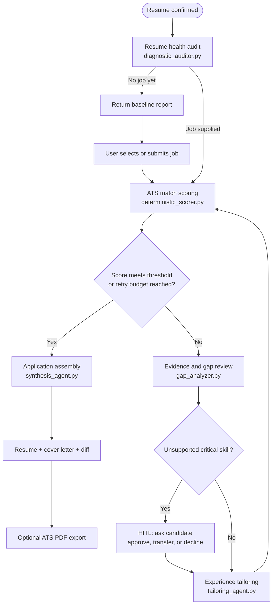
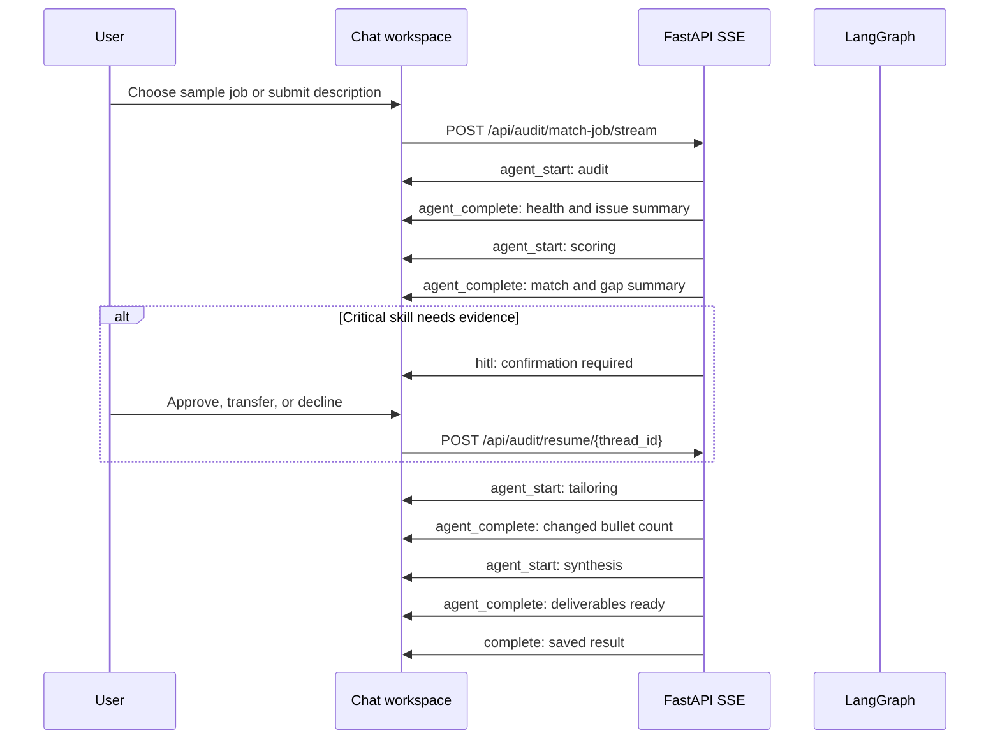

<div align="center">

# AgenticATS

### A focused resume audit and job-tailoring workspace

Parse a resume into a fact-locked structure, measure its baseline quality, compare it with a target role, ask for confirmation when evidence is missing, and produce a grounded tailored application.

[](https://fastapi.tiangolo.com)
[](https://react.dev)
[](https://python.langchain.com)
[](https://langchain-ai.github.io/langgraph/)
[](https://groq.com)
[](https://www.postgresql.org)

</div>

---

## What the application does

AgenticATS is a small, stateful workflow rather than a general-purpose chatbot. It helps a candidate move from a resume to a role-specific application:

1. Upload a PDF or paste resume text.
2. Convert the resume into a structured `ResumeAST`.
3. Run a deterministic health audit.
4. Select or paste a target job description.
5. Calculate a reproducible ATS match score.
6. Pause for confirmation when an important skill is not supported by the resume.
7. Tailor existing bullets with LangChain structured output.
8. Assemble a fact-preserving Markdown resume and grounded cover letter.
9. Export the result as a PDF.

The interface presents each workflow node as a live execution plan. Users see which agent is pending, running, waiting for confirmation, or complete, without exposing private model reasoning.

## Architecture at a glance

The frontend and backend are intentionally simple. LangGraph owns state and routing; LangChain owns model calls and structured output; deterministic Python code owns scoring, validation, and document assembly.



### Why this split matters

- **Deterministic code** produces health and ATS scores. The model does not invent a rating.
- **The `ResumeAST`** is the source of truth for identity, companies, dates, education, and original bullets.
- **LangChain structured output** is used only where language generation is useful: bullet rewriting and cover letters.
- **LangGraph** pauses and resumes the workflow around human verification.
- **SSE events** expose node lifecycle events to the chat UI.

## The workflow

This is the workflow currently implemented in `backend/app/core/graph.py`. It is a small sequential graph with one bounded tailoring pass by default, not a large autonomous swarm or an unbounded loop.



### Workflow agents and services

| Component | Responsibility | Model call? |
| --- | --- | --- |
| PDF vision parser | Renders every PDF page and extracts a structured resume AST | Yes, vision model |
| Text resume parser | Parses pasted text and normalizes it into the same AST | Optional, with deterministic fallback |
| Resume health auditor | Scores structure, content impact, metrics, action verbs, and regional norms | No |
| Deterministic ATS scorer | Compares required skills, semantic similarity, and bullet quality | No |
| Gap analyzer | Finds missing critical skills and decides whether to ask the user | No |
| Tailoring agent | Rewrites existing bullets while preserving facts | Yes, LangChain structured output |
| Synthesis agent | Builds the resume from AST facts and generates a grounded cover letter | One LangChain text call |

The model is configured centrally through `init_chat_model` in `backend/app/core/llm.py`. The default chat model is `openai/gpt-oss-20b` through Groq; the PDF parser model is configured separately.

## Frontend execution feedback

The target job stream uses LangGraph lifecycle events. The UI receives `agent_start` and `agent_complete` events and renders the full plan before all nodes have run.



The UI deliberately shows observable work summaries, not hidden chain-of-thought. Examples include:

- `Resume health 82% · 3 issue(s) found`
- `ATS match 74% · 8 matched · 4 missing`
- `3 bullet(s) improved`
- `Resume and cover letter are ready`

## Scoring and quality controls

The ATS score is deterministic:

```text
final_score =
    0.40 * exact_keyword_overlap
  + 0.40 * semantic_similarity
  + 0.20 * bullet_quality
```

The health audit separately evaluates:

- Contact information and resume structure
- Presence of a professional summary and skills section
- Experience entries and achievement bullets
- Quantifiable metrics
- Action-oriented bullet openings
- Passive or weak phrasing
- English/US/UK and French resume conventions

The score is bounded to a realistic `25–98` range. Missing evidence lowers the score; the model cannot raise it by persuasion.

## Quick start

### Docker Compose

```bash
git clone https://github.com/AliBnh/agentic-ats.git
cd agentic-ats
cp .env.example .env
# Set GROQ_API_KEY in .env
docker compose up -d --build
```

Open:

- Web app: [http://localhost:3005](http://localhost:3005)
- FastAPI docs: [http://localhost:8000/docs](http://localhost:8000/docs)
- Prometheus: [http://localhost:9090](http://localhost:9090)
- Grafana: [http://localhost:3001](http://localhost:3001)
- Qdrant dashboard: [http://localhost:6333/dashboard](http://localhost:6333/dashboard)

### Demo account

The application can sign in with the seeded demo account:

| Field | Value |
| --- | --- |
| Email | `demo@agenticats.com` |
| Password | `Password123!` |
| Display name | Demo User |

The chat workspace also includes one-click sample resumes and job descriptions. Existing Ali BENHIMA sample resumes remain available alongside the Mohamed Elmasrar and Salaheddine Benghemid examples.

### Local development

Backend:

```bash
cd backend
python -m venv .venv
source .venv/bin/activate
uv pip install -r requirements.txt
uvicorn app.main:app --host 0.0.0.0 --port 8000 --reload
```

Frontend:

```bash
cd frontend
npm install
npm run dev
```

## Configuration

The important settings are in `.env`:

```env
GROQ_API_KEY=your_groq_api_key
MODEL_PROVIDER=groq
MODEL_NAME=openai/gpt-oss-120b
PARSER_MODEL_NAME=qwen/qwen3.8-27b
MODEL_TEMPERATURE=0.0
```

Optional LangSmith tracing:

```env
LANGSMITH_TRACING=true
LANGSMITH_API_KEY=your_langsmith_api_key
LANGSMITH_PROJECT=agentic-ats
```

## API surface

| Method | Endpoint | Purpose |
| --- | --- | --- |
| `POST` | `/api/auth/login` | Authenticate a user |
| `POST` | `/api/auth/register` | Create an account |
| `GET` | `/api/auth/me` | Read the current user |
| `POST` | `/api/audit/upload` | Upload a PDF or resume text |
| `POST` | `/api/audit/confirm-parsing` | Confirm the parsed resume and run the health audit |
| `POST` | `/api/audit/match-job` | Run the non-streaming job workflow |
| `POST` | `/api/audit/match-job/stream` | Run the workflow with SSE agent events |
| `POST` | `/api/audit/resume/{thread_id}` | Resume after skill verification |
| `GET` | `/api/audit/result/{thread_id}` | Retrieve the saved audit result |
| `POST` | `/api/audit/export/pdf` | Export resume or cover letter PDF |
| `GET` | `/api/threads/samples/catalog` | Read sample resumes and jobs |
| `GET` | `/metrics` | Prometheus metrics |

## Project structure

```text
backend/app/
├── agents/
│   ├── diagnostic_auditor.py
│   ├── deterministic_scorer.py
│   ├── gap_analyzer.py
│   ├── pdf_parser.py
│   ├── resume_text_parser.py
│   ├── synthesis_agent.py
│   └── tailoring_agent.py
├── api/
├── core/
│   ├── graph.py
│   └── llm.py
├── prompts.py
└── schemas/state.py

frontend/src/
├── components/
│   ├── ChatWorkspace.jsx
│   ├── StudioEditor.jsx
│   └── ui/
├── context/
├── services/api.js
└── App.jsx
```

## Testing

```bash
cd backend
pytest tests/test_engine.py -v
pytest tests/test_real_world_e2e.py -v
```

Frontend production build:

```bash
cd frontend
npm run build
```

## Design principles

- Prefer deterministic checks over model-generated confidence.
- Never invent candidate facts, metrics, employers, dates, or qualifications.
- Keep model calls small, isolated, and typed where possible.
- Pause for human confirmation when the resume does not support a critical claim.
- Show observable workflow progress without exposing private reasoning.
- Keep the interface focused on one resume and one target role at a time.
